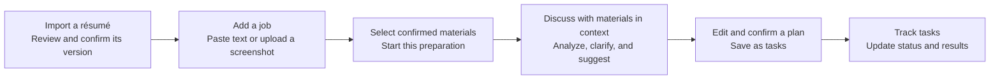
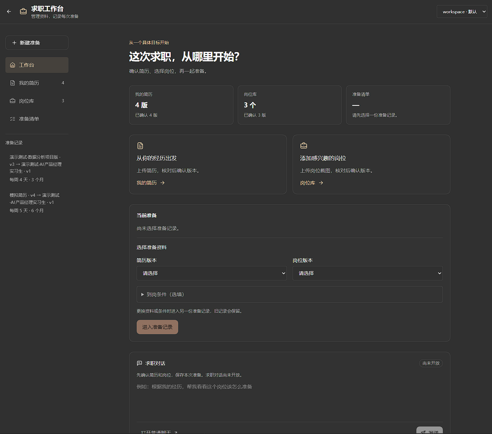
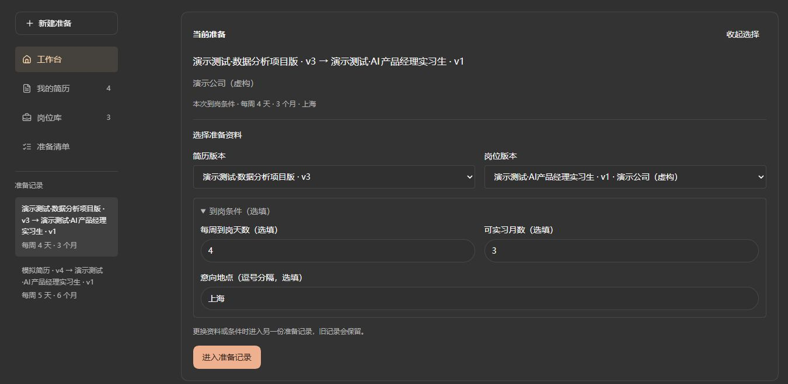
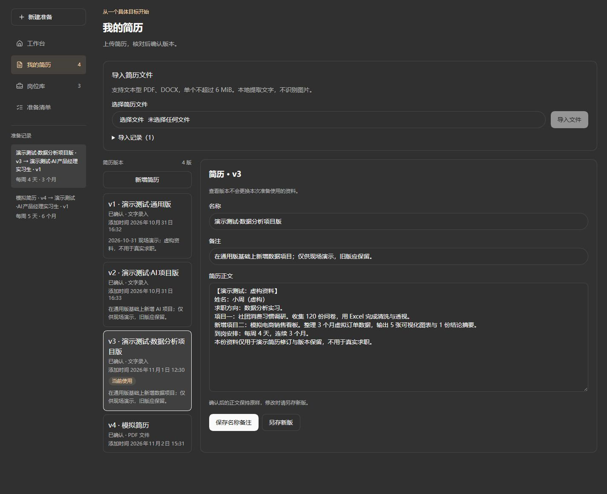
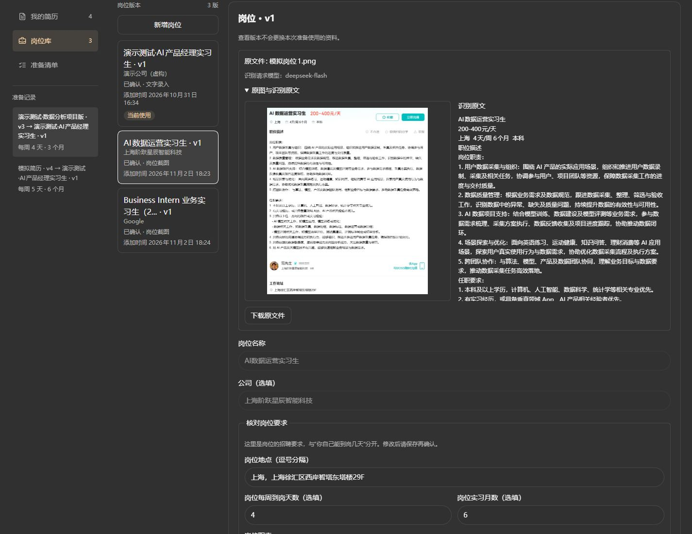
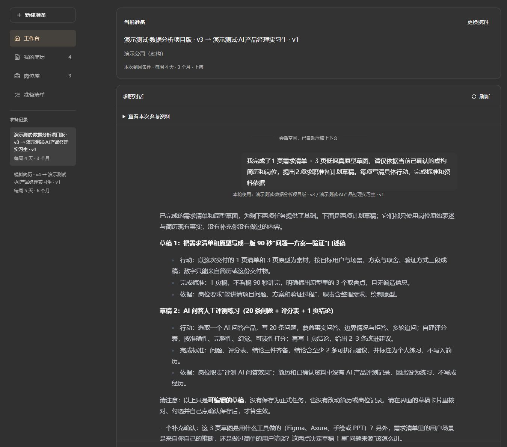
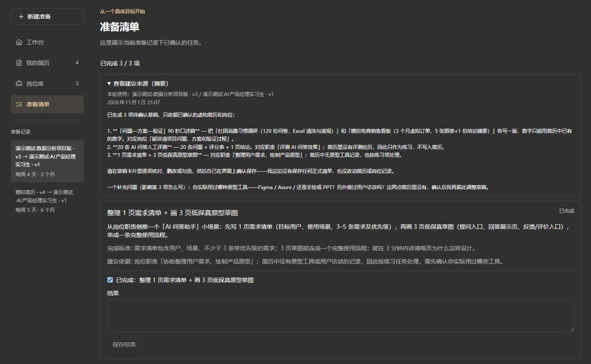

# Job Hunting Workbench

[简体中文](./README.md)

**Let AI use your résumé and target job to turn your preparation into actions you can track.**

An AI job-preparation workbench built on [nanobot](https://github.com/HKUDS/nanobot), designed for people seeking internships and entry-level roles. Manage multiple résumé versions, organize target jobs, discuss your preparation with the selected materials in context, and save the suggestions you confirm as preparation tasks.

Supports text entry, PDF / DOCX résumé import, and job screenshot recognition for PNG / JPG / WEBP images. Materials, preparation records, and tasks are stored in your local instance. AI capabilities come from the model service you configure.

[Workflow](#workflow) · [Screenshots](#screenshots) · [Quick Start](#quick-start) · [Development and Verification](#development-and-verification) · [Project Origins](#project-origins-and-license)

## Why This Project

When preparing for a job, your résumés sit in folders, job requirements are scattered across recruitment pages and screenshots, and AI suggestions remain in separate conversations. Switching to another job often means uploading your materials and explaining your background again. Even after a useful conversation, the next action can remain unclear.

This workbench connects those pieces in one preparation workflow: choose the résumé version and target job for this preparation, ground the discussion in those materials, and keep track of the suggestions you decide to act on.

For example, suppose you have a “General” résumé and an “AI Projects” résumé, and you are preparing for an AI product manager internship. Select the “AI Projects” version and the target job, then ask the assistant to compare your experience with the requirements. If it suggests preparing a project case study, review and edit the task before adding it to your list, then record the result when you finish.

## Workflow



1. **Organize your résumés**: paste the text or import a PDF / DOCX, review the extracted content, and keep separate versions for different job directions.
2. **Add a job**: paste the job description or upload a screenshot. Compare the recognized text with the original image, make corrections, then save and confirm the job version.
3. **Start preparing**: select a confirmed résumé and a confirmed job in the workbench, add your availability for this preparation, and enter the corresponding preparation record.
4. **Discuss your materials**: ask about job requirements, gaps in your experience, or ways to prepare. The interface shows the materials used for each turn; you can explain additional experience in the conversation.
5. **Confirm preparation tasks**: ask the assistant to propose a plan, edit the task details, supporting evidence, and completion criteria, then select the items you want and confirm them.
6. **Record progress**: update task status and results in the preparation list, then continue the discussion with your latest progress.

You can start with questions like these:

> Based on this résumé and target job, which parts of my experience most need clarification?
>
> Ask me a few questions to understand my project experience before suggesting how to prepare.
>
> Propose a preparation plan, with supporting evidence and completion criteria for each task.

<a id="-webui"></a>

## Screenshots

The following six images show the locally running workbench, existing demo materials, imported jobs, and conversation history. The first image provides a homepage overview. The remaining views follow the preparation workflow; click their titles to expand them.

**1. Workbench overview: start with a specific goal**

The homepage brings together your résumés, jobs, preparation list, and existing preparation records. No preparation record is selected in this screenshot. Selecting the materials lets you enter the corresponding career conversation.



<details>
<summary>2. Select the materials for this preparation</summary>

Choose a résumé version, a job version, and your availability so each preparation record has a clear goal and reference materials.



</details>

<details>
<summary>3. Manage résumé versions: distinguish versions, sources, and the version in use</summary>

Keep multiple versions of the same experience for different job directions. The version list shows names, sources, and confirmation status. Viewing another version does not change the materials used by the current preparation.



</details>

<details>
<summary>4. Review job screenshots: compare the original image, recognized text, and job fields</summary>

The original job image and recognized text appear side by side, with the source file and requested recognition model preserved. After review, the information becomes a job version; you can still revisit the original image and confirmed fields.



</details>

<details>
<summary>5. Continue the conversation with your materials: get preparation suggestions grounded in your experience</summary>

Each turn shows the résumé and job versions it uses. Existing experience, user-provided additions, and proposed practice activities are distinguished. Suggestions include an action, completion criteria, and supporting evidence from the materials.



</details>

<details>
<summary>6. Track confirmed tasks: review sources, completion criteria, and progress</summary>

Tasks enter the preparation list after user confirmation. They retain their suggestion sources and completion criteria, and support status updates and result notes.



</details>

## Core Features and Design

| Feature | What it does | Why it works this way |
| --- | --- | --- |
| Résumé version management | Distinguishes names, versions, sources, and confirmation status; editing confirmed content requires a new version | Prepare materials for different jobs while preserving the versions used in earlier discussions |
| Résumé file import | Extracts text locally from text-based PDF / DOCX files and retains the original files, extracted text, and review controls | Let users check where information came from and what needs correcting |
| Job screenshot recognition | Recognizes job titles, companies, locations, responsibilities, and qualifications; supports original-image review, corrections, and retries | Turn screenshots into usable materials while retaining notices about missing, truncated, or conflicting information |
| Conversations with materials in context | Binds a confirmed résumé, job, and availability, retaining reference materials for each turn | Keep the basis of earlier replies clear when materials change during preparation |
| Preparation plan confirmation | AI proposes drafts; users select, edit, and confirm items before tasks are created | Let users decide which suggestions deserve their time |
| Task tracking | Saves completion status and results, with access to suggestion sources | Turn discussion outcomes into follow-up actions |
| Local persistence | Stores business materials, original files, and preparation records by workspace | Continue after a refresh or restart without depending on temporary browser state |

### What AI, the Software, and the User Do

| Participant | Responsibilities |
| --- | --- |
| AI | Understand job screenshots, analyze and ask questions using the materials, and propose preparation suggestions and plan drafts |
| Software | Extract résumé text, manage versions, validate explicit numeric availability conditions, and save materials and tasks |
| User | Review materials and recognition results, add actual experience, and choose the versions and tasks to confirm |

PDF / DOCX résumés are read by local document parsers. Job screenshots are recognized by the configured model, whose service must support image input. AI suggestions still need review; experience absent from the materials should remain unknown until clarified.

### How Conversations Relate to Materials

Each preparation record binds the selected résumé version, job version, and personal availability. Each analysis turn also retains a snapshot of the materials at that time. Retries and late replies continue to use their original reference materials. Viewing another version does not switch the materials used by the current preparation.

Ordinary chat remains available. Only conversations bound to a preparation record include the corresponding career materials. After a career conversation is successfully deleted, its preparation record and associated task list disappear from the workbench. Shared résumés and jobs remain in their libraries.

## Quick Start

### 1. Prepare Your Environment

- Python **3.11 or newer**.
- Git.
- Bun, used to build the frontend when running from source.
- A working model service; job screenshot recognition requires image input support.

This project currently runs from source. Clone this repository: the upstream PyPI package and upstream one-command installer do not include the career features added here. The internal Python package and command still use the name `nanobot`.

### 2. Clone and Create a Virtual Environment

```bash
git clone https://github.com/Egcoo/job-hunting-workbench.git
cd job-hunting-workbench
python -m venv .venv
```

### 3. Install and Open the Interface

**Windows PowerShell**

```powershell
.\.venv\Scripts\python.exe -m pip install -e .
.\.venv\Scripts\python.exe -m nanobot webui
```

**macOS / Linux**

```bash
./.venv/bin/python -m pip install -e .
./.venv/bin/python -m nanobot webui
```

The first source launch builds the WebUI as needed and requires downloading frontend dependencies. Wait until the terminal reports that it is ready, then use the browser page opened automatically or the complete login link printed in the terminal.

### 4. Configure a Model and Start Preparing

1. Follow the initial setup wizard, or configure the model service, connection details, and model in **Settings → Models**.
2. Confirm that the model can reply in ordinary chat.
3. Click **Career workbench** in the sidebar, open **Resumes**, import or paste your materials, and confirm a version.
4. Open **Jobs**, add and confirm a target job, then return to the workbench to select your materials.
5. Discuss your preparation in the career conversation. When you need an action plan, ask the assistant to propose a draft, then edit and confirm it in the interface.

A new instance starts with no career materials; add your own. You can use fictional materials for your first attempt.

See the [model service guide](./docs/providers.md) and [configuration documentation](./docs/configuration.md) for connection and configuration details. When updating the source for an existing instance, consult [updates and recovery](./docs/updating.md), then update and restart using the source-installation procedure.

## Data Storage and Current Limitations

The default instance stores career files under:

```text
~/.nanobot/
└── career/
    └── <workspace-id>/
        ├── career.sqlite3   # Résumés, jobs, preparation records, analyses, plans, and tasks
        ├── resume-files/   # Original imported résumé files
        └── job-images/     # Original uploaded job images
```

When using another configuration instance, the data directory changes with that instance. Career data is stored separately for each workspace. Chat history is still managed by nanobot's original session module. See the [career module guide](./nanobot/career/README.md) for details.

Local storage and model calls are separate: career conversations send the necessary content from selected materials to your configured model service, and job recognition sends a processed copy of the image. Context filtering removes common contact details and local paths, but does not provide complete anonymization.

Current limitations:

- Résumé import supports PDF / DOCX files with extractable text. Scanned, encrypted, or damaged files may not be readable; text entry is available as an alternative.
- Each résumé file or job image must be no larger than **6 MiB**. Job image recognition is also subject to resolution limits and model service capabilities.
- Job recognition results require manual review. If recognition fails, retry the original image or fill in the information manually and save a draft.
- Editing confirmed résumé or job content requires a new version. Changing availability for the current preparation also takes you to a different preparation record.
- The current scope covers material organization, preparation discussions, and task tracking. Automated job search, applications, and recruiter communication workflows are not provided.

## Development and Verification

### Implementation Structure

The Python gateway owns model execution, sessions, tools, business rules, and permissions. The React WebUI handles input and presentation. Career features reuse the existing runtime and transport mechanisms, with business data stored in a separate SQLite database.

| Location | Purpose |
| --- | --- |
| [`nanobot/career/`](./nanobot/career/) | Career models, storage, versions, material snapshots, file imports, and task rules |
| [`nanobot/webui/career_api.py`](./nanobot/webui/career_api.py) | Workbench API, preparation-to-session binding, and operation validation |
| [`nanobot/webui/career_policy.py`](./nanobot/webui/career_policy.py) | Tool-use boundaries for career conversations |
| [`nanobot/webui/career_tools.py`](./nanobot/webui/career_tools.py) | Converts model proposals into plan drafts awaiting user confirmation |
| [`nanobot/webui/job_image_recognition.py`](./nanobot/webui/job_image_recognition.py) | Reuses the model runtime to recognize job images and validate structure and source-text references |
| [`webui/src/components/career/`](./webui/src/components/career/) | Workbench, résumés, jobs, conversations, plan confirmation, and preparation list interfaces |
| [`nanobot/templates/agent/career_preparation.md`](./nanobot/templates/agent/career_preparation.md) | Rules for material use, clarification, and suggestions in career preparation |
| [`tests/career/`](./tests/career/) and [`webui/browser/career-real.spec.ts`](./webui/browser/career-real.spec.ts) | Business tests and end-to-end browser workflow verification |

### What Existing Verification Covers

Stage-specific verification records are documented in the [career module guide](./nanobot/career/README.md). They include business and API regressions, frontend component checks, browser workflows in isolated instances, and a small set of real-file and live-model sample checks.

| Verification layer | Coverage |
| --- | --- |
| Business logic and API | Version and confirmation rules, workspace isolation, task saving, database migrations, file sources, and operation ownership |
| Browser interactions | Import and review, conversations with materials, plan editing and confirmation, task tracking, and recovery after refresh or restart |
| Live-model samples | Job image recognition, analysis using corrected fields, multi-turn conversations, and plan proposals |

By default, browser engineering tests use fixed model outputs to check the flow through the real WebUI, API, and persistence layers. Live-model checks are recorded separately. Passing tests and successful sample runs do not establish overall recognition accuracy or job-seeking outcomes.

### Local Checks

Install development dependencies and run the relevant backend tests from the repository root:

```powershell
.\.venv\Scripts\python.exe -m pip install -e ".[dev]"
.\.venv\Scripts\python.exe -m pytest tests/career tests/webui/test_career_api.py tests/webui/test_job_image_recognition.py -q
```

Targeted frontend tests:

```bash
cd webui
bun install --frozen-lockfile
bun run test src/tests/career-workbench.test.tsx src/tests/career-plans.test.tsx src/tests/job-image.test.tsx
```

Run browser workflows with `bun run test:career` from `webui/`. A working Playwright browser is required; use `PLAYWRIGHT_CHROMIUM_EXECUTABLE_PATH` to point to an installed Chrome. Tests use temporary instances and test materials. See the [WebUI development guide](./webui/README.md) for environment requirements and frontend development instructions.

On macOS / Linux, replace the Python path in backend commands with `./.venv/bin/python`.

## What's Next

The core preparation workflow is implemented. The next stage focuses on building systematic evaluation samples, assessing the quality of job recognition, material analysis, and plan suggestions, and improving failure handling and interactions based on usage feedback.

## Project Origins and License

This project is based on [HKUDS/nanobot](https://github.com/HKUDS/nanobot) and retains its upstream code and development history. Thanks to the original project and its contributors.

- **Reused foundations**: model calls, the agent runtime, sessions, tools, permission policies, the WebUI, and general-purpose features.
- **Career features added in this repository**: material and version management, résumé file import, job screenshot recognition and review, conversations bound to materials, suggestion confirmation, task tracking, and related verification.

The original chat, apps, skills, scheduled tasks, and chat channel entry points remain available. For additional usage, see the [general documentation index](./docs/README.md), [WebUI user guide](./docs/webui.md), [architecture documentation](./docs/architecture.md), and [contribution guide](./CONTRIBUTING.md). General installation and release documentation retains upstream conventions; use the source-startup steps in this README for this project.

The code retains the [MIT License](./LICENSE), existing copyright notices, and [third-party notices](./THIRD_PARTY_NOTICES.md). Internal package names and commands remain compatible with the existing nanobot runtime.
