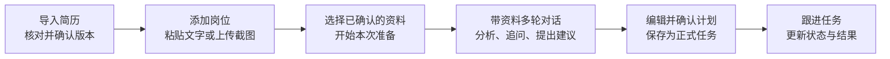
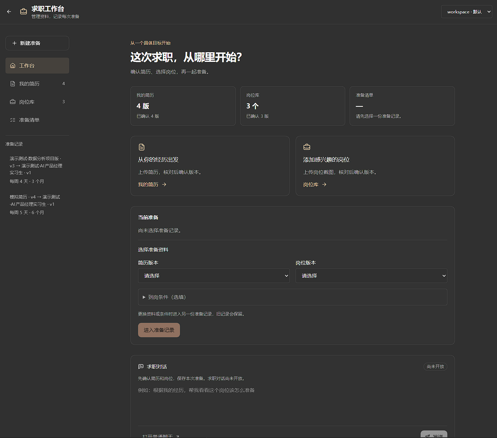
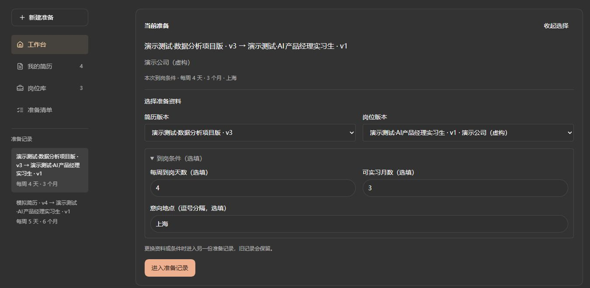
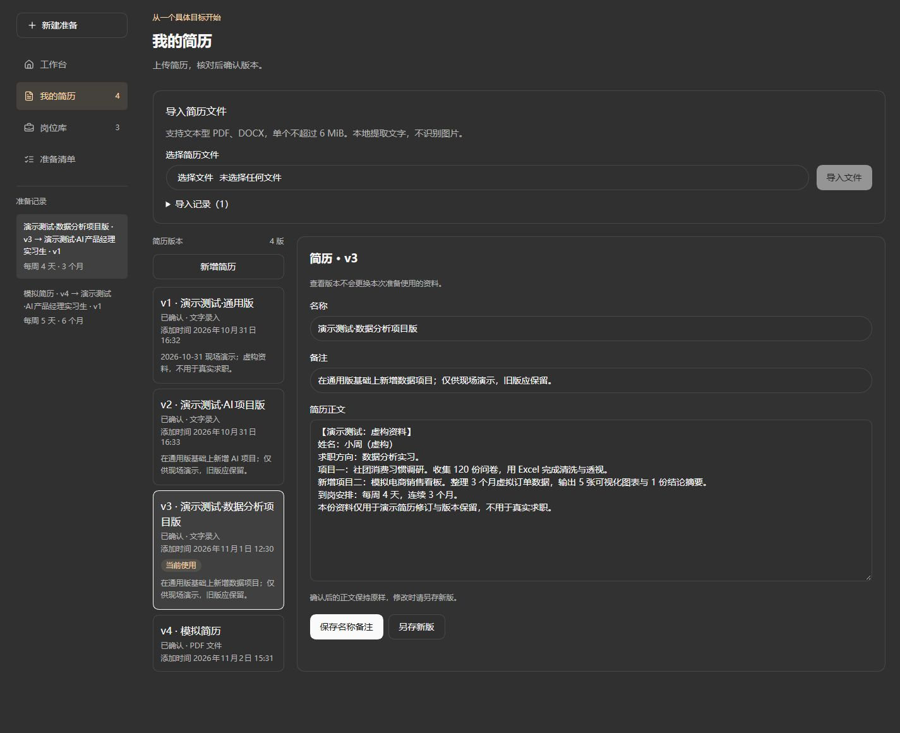
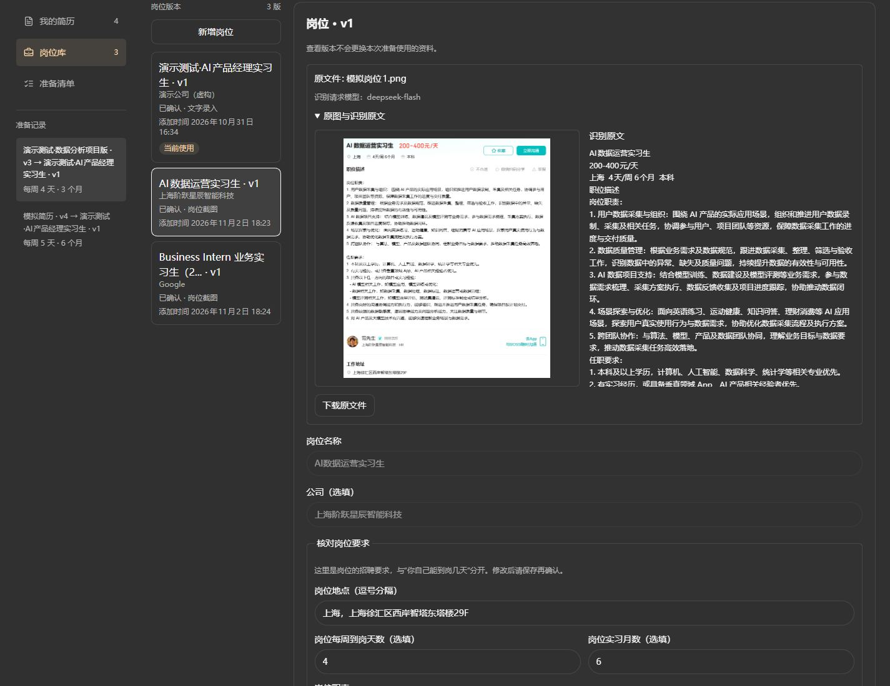
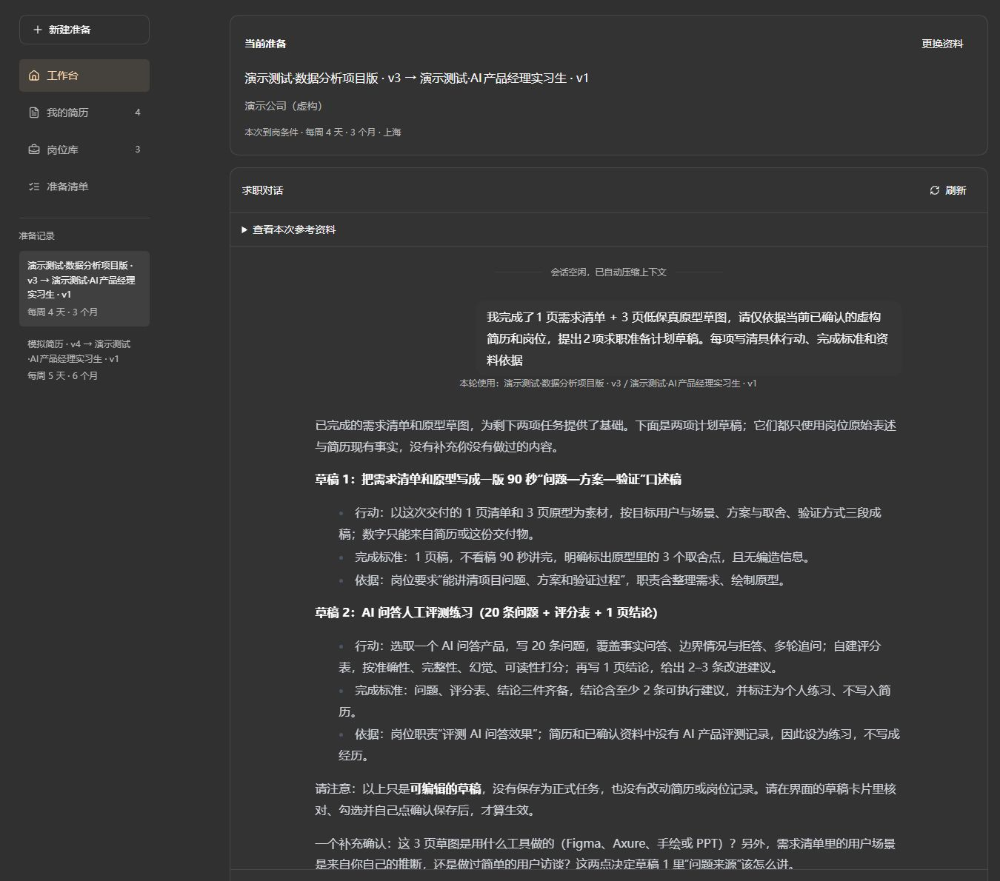
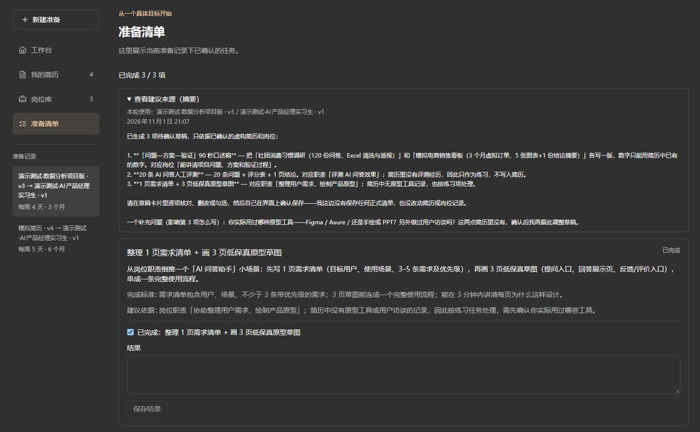

# 求职工作台 · Job Hunting Workbench

[English](./README.en.md)

**让 AI 结合你的简历和目标岗位，把求职准备拆成可以跟进的行动。**

基于 [nanobot](https://github.com/HKUDS/nanobot) 构建的 AI 求职准备工作台，面向正在准备实习和初级岗位的求职者。你可以管理多版简历、整理目标岗位、带着选定资料进行多轮对话，再将确认后的建议保存为准备任务。

支持文字录入、PDF / DOCX 简历导入，以及 PNG / JPG / WEBP 岗位截图识别。资料、准备记录和任务保存在本地实例中，AI 能力由你配置的模型服务提供。

[使用流程](#使用流程) · [界面预览](#界面预览) · [快速开始](#快速开始) · [开发与验证](#开发与验证) · [项目来源](#项目来源与许可)

## 为什么做这个项目

准备求职时，简历放在文件夹里，岗位要求散落在招聘页面和截图中，AI 给出的建议又留在不同的聊天里。换一个岗位，往往还要重新上传资料、介绍经历；聊完之后，也容易不知道接下来该做什么。

这个工作台把这些内容放进同一条准备流程：明确这次使用哪份简历、准备哪个岗位，让讨论有资料依据，让确认后的建议有地方继续跟进。

例如，你有“通用版”和“AI 项目版”两份简历，正在准备一个 AI 产品经理实习岗位。你可以选定“AI 项目版”和该岗位，让助手对照经历与要求进行讨论；如果建议整理一个项目案例，就先核对、修改任务内容，再保存到清单，完成后记录结果。

## 使用流程



1. **整理简历**：粘贴正文或导入 PDF / DOCX，核对提取内容，为不同求职方向保留不同版本。
2. **添加岗位**：粘贴岗位说明，或上传岗位截图。对照原图检查识别结果，修正后保存并确认岗位版本。
3. **开始准备**：在工作台选择一份已确认简历和一个已确认岗位，补充本次到岗条件，进入对应准备记录。
4. **结合资料对话**：询问岗位要求、经历差距或准备方法。界面展示本轮参考资料；需要补充的经历可以在对话中说明。
5. **确认准备任务**：请助手提出准备计划，编辑任务内容、依据和完成标准，选择需要的项目并确认保存。
6. **记录进展**：在准备清单中更新完成状态和结果，带着新进展继续讨论。

可以从这些问题开始：

> 根据这份简历和目标岗位，我最需要补充说明哪些经历？
>
> 请先问我几个问题，确认我的项目经历，再给出准备建议。
>
> 帮我拟一份准备计划，每项任务都写清楚依据和完成标准。

<a id="-webui"></a>

## 界面预览

以下 6 张图片展示本地运行的工作台、已有演示资料、岗位导入结果与历史对话。首张为工作台首页总览，其余界面按使用流程排列，可点击标题展开查看。

**1. 工作台总览：从一个具体目标开始**

首页集中展示简历、岗位和准备清单入口，以及已有准备记录。图中尚未选择准备记录，选定资料后即可进入对应求职对话。



<details>
<summary>2. 选定这次准备使用的资料</summary>

选择简历版本、岗位版本和到岗条件，让每份准备记录有明确的目标与资料依据。



</details>

<details>
<summary>3. 管理多版本简历：区分版本、来源和当前使用状态</summary>

同一份经历可以为不同方向保留多个版本。版本列表展示名称、来源和确认状态，查看其他版本不会更换本次准备使用的资料。



</details>

<details>
<summary>4. 核对岗位截图：对照原图、识别原文和岗位字段</summary>

岗位原图与识别文字并排展示，保留文件来源和识别请求模型。核对后形成岗位版本，后续仍可回看原图与已确认字段。



</details>

<details>
<summary>5. 带资料继续对话：结合经历提出有依据的准备建议</summary>

每轮消息显示所用简历和岗位版本。已有经历、用户补充与准备练习分别说明，建议同时包含行动、完成标准和资料依据。



</details>

<details>
<summary>6. 跟进正式任务：查看来源、完成标准和进度</summary>

用户确认后的任务进入准备清单，保留建议来源与完成标准，支持更新完成状态和记录结果。



</details>

## 核心功能与设计

| 功能 | 可以做什么 | 这样设计的原因 |
| --- | --- | --- |
| 简历版本管理 | 区分名称、版本、来源和确认状态；已确认正文修改时另存新版 | 针对不同岗位准备材料，并保留过去讨论使用的版本 |
| 简历文件导入 | 本地提取文本型 PDF / DOCX，保留原文件、提取原文和核对入口 | 让用户能检查资料从哪里来、哪些内容需要修正 |
| 岗位截图识别 | 识别岗位名称、公司、地点、职责和任职条件，支持原图核对、修改与重试 | 将截图整理为可用资料，同时保留缺失、截断和矛盾提醒 |
| 带资料多轮对话 | 绑定已确认简历、岗位和本次条件，逐轮保留参考资料 | 避免讨论中切换资料后，历史回复的依据变得不清楚 |
| 准备计划确认 | AI 提议草稿，用户选择、编辑并确认后生成任务 | 让用户决定哪些建议值得投入时间 |
| 任务跟进 | 保存完成状态和结果，查看建议来源 | 将讨论结果落实到后续行动 |
| 本地持久化 | 按工作区保存业务资料、原文件和准备记录 | 刷新或重启后可以继续，不依赖浏览器临时状态 |

### AI、程序和用户分别负责什么

| 参与方 | 职责 |
| --- | --- |
| AI | 理解岗位截图，结合资料分析与追问，提出准备建议和计划草稿 |
| 程序 | 提取简历文字，管理版本，校验明确的到岗数字条件，保存资料与任务 |
| 用户 | 核对资料和识别结果，补充实际经历，决定使用的版本及正式任务 |

PDF / DOCX 简历由本地文档解析器读取；岗位截图由配置的模型识别，需要该模型服务支持图像输入。AI 给出的建议仍需核对，资料中没有的经历应保持未知并进一步确认。

### 对话与资料如何对应

每份准备记录绑定选定的简历版本、岗位版本和个人条件。每轮分析还会保留当时的资料快照，重试或迟到回复继续使用原来的依据。查看其他版本不会切换当前准备使用的资料。

普通聊天继续保留；只有绑定到求职准备记录的对话才会带入相应求职资料。删除求职对话成功后，对应准备记录和关联清单从工作台移除，简历库与岗位库中的共享资料保留。

## 快速开始

### 1. 准备环境

- Python **3.11 或更新版本**。
- Git。
- Bun，用于源码运行时构建前端。
- 一个可用的模型服务；使用岗位截图识别时，需要图像输入能力。

本项目目前按源码方式运行。请克隆本仓库；上游 PyPI 包和上游一键安装脚本不包含本仓库新增的求职功能。内部 Python 包和命令仍沿用 `nanobot`。

### 2. 克隆并创建虚拟环境

```bash
git clone https://github.com/Egcoo/job-hunting-workbench.git
cd job-hunting-workbench
python -m venv .venv
```

### 3. 安装并打开界面

**Windows PowerShell**

```powershell
.\.venv\Scripts\python.exe -m pip install -e .
.\.venv\Scripts\python.exe -m nanobot webui
```

**macOS / Linux**

```bash
./.venv/bin/python -m pip install -e .
./.venv/bin/python -m nanobot webui
```

首次源码启动会按需构建 WebUI，需要下载前端依赖。等待终端显示就绪后，使用自动打开的浏览器页面或终端给出的完整登录链接进入。

### 4. 配置模型并开始准备

1. 根据首次设置向导，或在 **设置 → 模型** 中配置模型服务、连接信息和模型。
2. 先用普通聊天确认模型能够回复。
3. 点击侧栏 **求职工作台**，进入 **我的简历**，导入或粘贴资料并确认版本。
4. 进入 **岗位库**，添加并确认目标岗位，再回工作台选择资料。
5. 在求职对话中讨论准备方向；需要行动计划时，请助手提出草稿，再到界面编辑确认。

新实例的求职资料初始为空，需要自行添加。首次尝试可以使用虚构资料。

模型连接和配置细节见[模型服务说明](./docs/providers.md)与[配置文档](./docs/configuration.md)。使用已有实例更新源码时，先参考[更新与恢复](./docs/updating.md)，按源码安装方式更新和重启。

## 数据保存与当前边界

默认实例的求职业务文件位于：

```text
~/.nanobot/
└── career/
    └── <workspace-id>/
        ├── career.sqlite3   # 简历、岗位、准备记录、分析、计划和任务
        ├── resume-files/   # 导入的简历原文件
        └── job-images/     # 上传的岗位原图
```

指定其他配置实例时，数据目录随实例变化；工作区之间的求职数据分别保存。聊天历史仍由 nanobot 的原会话模块管理。详情见[求职业务模块说明](./nanobot/career/README.md)。

本地保存与模型调用是两件事：求职对话会把选定资料的必要内容发送到你配置的模型服务，岗位识别会发送处理后的图片副本。上下文会过滤常见联系方式和本地路径，但这不等于完整匿名化。

当前使用边界：

- 简历导入面向可提取文字的 PDF / DOCX；扫描件、加密或损坏文件可能无法读取，可改为文字录入。
- 简历和岗位图片单文件均不超过 **6 MiB**。岗位图识别还受分辨率和模型服务能力限制。
- 岗位识别结果需要人工核对；识别失败时可重试原图，或手动填写后保存草稿。
- 修改已确认简历或岗位正文需要另存新版本。当前修改本次到岗条件也会进入另一份准备记录。
- 当前范围是资料整理、准备讨论和任务跟进，尚未提供自动搜岗、自动投递或联系招聘方的流程。

## 开发与验证

### 实现结构

Python gateway 负责模型执行、会话、工具、业务规则和权限；React WebUI 负责输入与展示。求职功能复用既有运行时和传输机制，业务数据使用独立 SQLite 数据库。

| 位置 | 作用 |
| --- | --- |
| [`nanobot/career/`](./nanobot/career/) | 求职业务模型、存储、版本、资料快照、文件导入和任务规则 |
| [`nanobot/webui/career_api.py`](./nanobot/webui/career_api.py) | 工作台接口、准备记录与会话绑定、操作校验 |
| [`nanobot/webui/career_policy.py`](./nanobot/webui/career_policy.py) | 求职对话的工具使用边界 |
| [`nanobot/webui/career_tools.py`](./nanobot/webui/career_tools.py) | 将模型提议转为待用户确认的计划草稿 |
| [`nanobot/webui/job_image_recognition.py`](./nanobot/webui/job_image_recognition.py) | 复用模型运行时识别岗位图，校验结构与原文引用 |
| [`webui/src/components/career/`](./webui/src/components/career/) | 工作台、简历、岗位、对话、计划确认和准备清单界面 |
| [`nanobot/templates/agent/career_preparation.md`](./nanobot/templates/agent/career_preparation.md) | 求职场景中的资料使用、追问和建议规则 |
| [`tests/career/`](./tests/career/) 与 [`webui/browser/career-real.spec.ts`](./webui/browser/career-real.spec.ts) | 业务测试与浏览器完整流程验证 |

### 已有验证覆盖什么

阶段验证记录见[求职业务模块说明](./nanobot/career/README.md)，包含业务和接口回归、前端组件检查、隔离实例的浏览器流程，以及少量真实文件和真实模型样例联调。

| 验证层次 | 覆盖内容 |
| --- | --- |
| 业务与接口 | 版本与确认规则、工作区隔离、任务保存、数据库迁移、文件来源和操作归属 |
| 浏览器交互 | 导入与核对、带资料对话、计划编辑确认、任务跟进、刷新和重启恢复 |
| 真实模型样例 | 岗位图片识别、字段修正后参与分析、多轮对话和计划提议 |

默认浏览器工程测试使用固定模型输出，检查真实 WebUI、接口与持久化之间的流程；真实模型联调单独记录。测试通过与少量样例成功不代表总体识别准确率或求职效果已经得到验证。

### 本地检查

在仓库根目录安装开发依赖，并运行相关后端测试：

```powershell
.\.venv\Scripts\python.exe -m pip install -e ".[dev]"
.\.venv\Scripts\python.exe -m pytest tests/career tests/webui/test_career_api.py tests/webui/test_job_image_recognition.py -q
```

前端定向测试：

```bash
cd webui
bun install --frozen-lockfile
bun run test src/tests/career-workbench.test.tsx src/tests/career-plans.test.tsx src/tests/job-image.test.tsx
```

浏览器流程使用 `webui/` 下的 `bun run test:career`，需要可用的 Playwright 浏览器；可用 `PLAYWRIGHT_CHROMIUM_EXECUTABLE_PATH` 指定已安装的 Chrome。测试使用临时实例与测试资料，具体环境及前端开发方式见 [WebUI 开发指南](./webui/README.md)。

macOS / Linux 将后端命令中的 Python 路径换为 `./.venv/bin/python`。

## 后续计划

核心准备流程已实现。下一阶段重点是建立系统化评测样本，检查岗位识别、资料分析和计划建议的质量，并结合实际使用反馈改进失败处理和交互。

## 项目来源与许可

本项目基于 [HKUDS/nanobot](https://github.com/HKUDS/nanobot) 开发，保留上游代码与开发历史，感谢原项目及贡献者。

- **复用的基础能力**：模型调用、Agent 运行时、会话、工具、权限策略、WebUI 及通用功能。
- **本仓库新增的求职能力**：资料与版本管理、简历文件导入、岗位截图识别与核对、资料绑定对话、建议确认、任务跟进及相关验证。

原有普通聊天、应用、技能、自动任务和聊天渠道入口继续保留。扩展使用可参考[通用文档索引](./docs/README.md)、[WebUI 使用指南](./docs/webui.md)、[架构文档](./docs/architecture.md)及[贡献指南](./CONTRIBUTING.md)；其中通用安装和发布说明沿用上游约定，本项目的启动以本文源码步骤为准。

代码沿用 [MIT License](./LICENSE)，现有版权声明与[第三方声明](./THIRD_PARTY_NOTICES.md)保留。内部包名及命令兼容既有 nanobot 运行方式。
